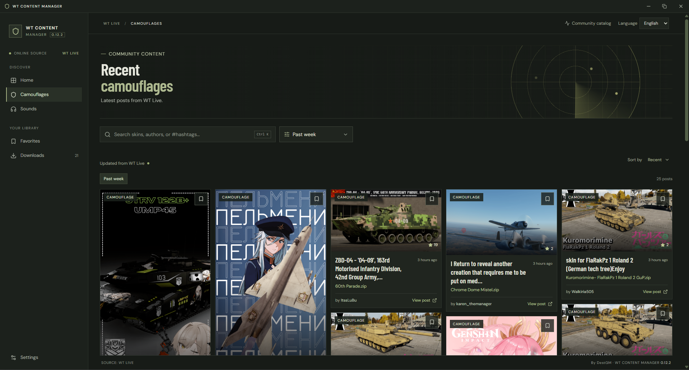

<div align="center">

# WT Content Manager

<p>
  
  
  
  <a href="LICENSE"></a>
</p>

</div>

An independent Windows desktop app for managing community-made War Thunder skins.



> WT Content Manager is not affiliated with or endorsed by Gaijin Entertainment or War Thunder. Their names and marks belong to their respective owners.

## Why I made it

I made this app to automate the repetitive work of finding and installing War Thunder community skins.

## Install

Download the latest Windows installer from [GitHub Releases](https://github.com/Eliezer-Gonzalez/Wt-Content-Manager/releases). If no installer is listed there yet, a release has not been published.

- The NSIS installer installs the app for the current Windows user.
- If Microsoft Edge WebView2 Runtime is missing, setup uses Microsoft's bootstrapper to download it. An internet connection is required.
- Windows SmartScreen may warn about an installer with limited reputation. Check that it came from this repository's Releases page; continue only if you trust the file.
- To uninstall, open **Windows Settings → Apps → Installed apps**, select **WT Content Manager**, and choose **Uninstall**.

## Use

1. Open the app and select your War Thunder installation if it was not detected automatically.
2. Browse the catalog, open a skin, and choose **Install**.
3. In War Thunder, select the matching vehicle, open **Customization**, and choose the skin from the user-skin list. Custom skins are local and visible only to you. See the [War Thunder custom skins guide](https://wiki.warthunder.com/cdk/creation_camo).

## Supported files and safety

Only ZIP skin archives are supported. During extraction, the app keeps supported skin and text files (`.blk`, `.dds`, `.tga`, `.png`, `.jpg`, `.jpeg`, `.csv`, `.txt`, and `.md`) and skips executables and other file types. It does not preview skins before installation or scan files for malware. Downloaded skins come from third parties; check their source and install them at your discretion.

## Privacy and diagnostics

Favorites, the selected game path, and preferences are stored locally. Diagnostic logs are enabled by default, stored on this device, and can be disabled in **Settings**. They are not uploaded automatically. If you include logs in a bug report, review them first.

Browsing and downloading skins requires an internet connection and contacts War Thunder Live and other relevant third-party services. Those services receive ordinary connection information, such as your IP address. The app does not require a Gaijin account.

## Report a problem or vulnerability

- For a bug, [open a GitHub issue](https://github.com/Eliezer-Gonzalez/Wt-Content-Manager/issues) with the app version, Windows version, steps to reproduce, and what happened. To copy recent logs, open **Settings → Diagnostic logs → Copy recent logs**; check the contents before sharing.
- For a security vulnerability, use GitHub's private **Report a vulnerability** option in the repository's **Security** tab. Do not post vulnerability details in a public issue.

## Development

The project uses React, TypeScript, Tailwind CSS, Tauri, and Rust. The frontend package manager is pnpm. [CONTRIBUTING.md](CONTRIBUTING.md) contains translation-file guidance.

### Development setup

Install Node.js, pnpm, and the Rust toolchain required by Tauri on Windows, then run:

```powershell
pnpm install --frozen-lockfile
pnpm tauri:dev
```

To build the app and Windows NSIS installer:

```powershell
pnpm tauri:build
```

The installer is written to `src-tauri/target/release/bundle/nsis/`.

To check the frontend build and translations:

```powershell
pnpm build
pnpm check:locales
```

## License

The project is distributed under [GNU GPL v3 or later](LICENSE). Third-party components and their notices are listed in [THIRD_PARTY_NOTICES.md](THIRD_PARTY_NOTICES.md).

---

# WT Content Manager (Español)

Aplicación de escritorio independiente para Windows que permite gestionar skins de War Thunder creadas por la comunidad.


> WT Content Manager no está afiliado ni cuenta con el respaldo de Gaijin Entertainment o War Thunder. Sus nombres y marcas pertenecen a sus respectivos dueños.

## Por qué la hice

Hice esta aplicación para automatizar el trabajo repetitivo de buscar e instalar skins de War Thunder creadas por la comunidad.

## Instalación

Descarga el instalador más reciente desde [GitHub Releases](https://github.com/Eliezer-Gonzalez/Wt-Content-Manager/releases). Si todavía no aparece uno, significa que aún no se ha publicado una versión.

- El instalador NSIS instala la aplicación para el usuario actual de Windows.
- Si falta Microsoft Edge WebView2 Runtime, el instalador usa el bootstrapper de Microsoft para descargarlo. Se necesita conexión a internet.
- Windows SmartScreen podría mostrar una advertencia si el instalador tiene poca reputación. Comprueba que venga de la sección Releases de este repositorio y continúa solo si confías en el archivo.
- Para desinstalarla, abre **Configuración de Windows → Aplicaciones → Aplicaciones instaladas**, selecciona **WT Content Manager** y pulsa **Desinstalar**.

## Uso

1. Abre la aplicación y selecciona la instalación de War Thunder si no se detectó automáticamente.
2. Explora el catálogo, abre una skin y pulsa **Instalar**.
3. En War Thunder, selecciona el vehículo correspondiente, abre **Personalización** y elige la skin en la lista de skins de usuario. Las skins personalizadas son locales y solo tú las ves. Consulta la [guía de skins personalizadas de War Thunder](https://wiki.warthunder.com/cdk/creation_camo).

## Archivos compatibles y seguridad

Solo se admiten archivos ZIP de skins. Al extraerlos, la aplicación conserva archivos compatibles de skins y texto (`.blk`, `.dds`, `.tga`, `.png`, `.jpg`, `.jpeg`, `.csv`, `.txt` y `.md`) y omite ejecutables y otros tipos de archivo. No muestra una vista previa antes de instalar ni analiza los archivos en busca de malware. Las skins descargadas son contenido de terceros; revisa su origen e instálalas bajo tu criterio.

## Privacidad y diagnósticos

Los favoritos, la ruta del juego y las preferencias se guardan localmente. Los registros de diagnóstico están activados por defecto, se guardan en este equipo y se pueden desactivar en **Ajustes**. No se envían automáticamente. Si incluyes registros en un reporte, revísalos primero.

Explorar y descargar skins requiere conexión a internet y se comunica con War Thunder Live y otros servicios de terceros. Esos servicios reciben información normal de conexión, como tu dirección IP. La aplicación no requiere una cuenta de Gaijin.

## Reportar un problema o una vulnerabilidad

- Para informar de un error, [crea un issue en GitHub](https://github.com/Eliezer-Gonzalez/Wt-Content-Manager/issues) e incluye la versión de la aplicación, la versión de Windows, los pasos para reproducirlo y lo que ocurrió. Para copiar registros recientes, abre **Ajustes → Registros de diagnóstico → Copiar registros recientes**; revisa su contenido antes de compartirlo.
- Para reportar una vulnerabilidad, usa la opción privada **Report a vulnerability** en la pestaña **Security** del repositorio. No publiques los detalles de la vulnerabilidad en un issue público.

## Desarrollo

El proyecto usa React, TypeScript, Tailwind CSS, Tauri y Rust. El gestor de paquetes del frontend es pnpm. [CONTRIBUTING.md](CONTRIBUTING.md) contiene instrucciones para los archivos de traducción.

### Preparar el entorno

Instala Node.js, pnpm y las herramientas de Rust que requiere Tauri en Windows. Luego ejecuta:

```powershell
pnpm install --frozen-lockfile
pnpm tauri:dev
```

Para compilar la aplicación y el instalador NSIS de Windows:

```powershell
pnpm tauri:build
```

El instalador queda en `src-tauri/target/release/bundle/nsis/`.

Para revisar la compilación del frontend y las traducciones:

```powershell
pnpm build
pnpm check:locales
```

## Licencia

El proyecto se distribuye bajo [GNU GPL v3 o posterior](LICENSE). Los componentes de terceros y sus avisos se enumeran en [THIRD_PARTY_NOTICES.md](THIRD_PARTY_NOTICES.md).
